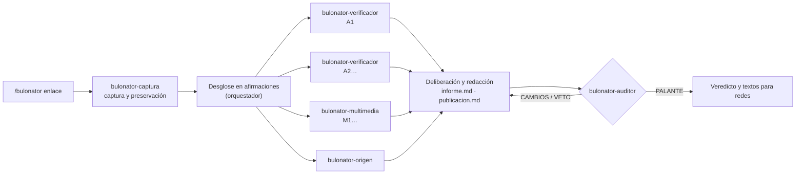

# Bulonator

**Skills y agentes para Claude Code, y una librería de Python con un motor multimodelo, que verifican si una noticia, un tuit, una imagen, un vídeo o un audio es un bulo, con la metodología del periodismo de verificación.**

```text
/bulonator https://x.com/usuario/status/1234567890
```

Bulonator hace siete cosas:

1. Captura y preserva el contenido.
2. Lo divide en afirmaciones comprobables.
3. Las contrasta con **fuentes oficiales y primarias**: BOE, boletines autonómicos, INE, Eurostat, Congreso, sentencias, agencias sanitarias…
4. Analiza las **imágenes, los vídeos y los audios**: metadatos, búsqueda inversa, fotogramas, IA, geolocalización y transcripción.
5. Rastrea el **origen y la difusión**: desmentidos previos, primera aparición, quién lo publica e indicios de difusión coordinada.
6. Somete el resultado a una **auditoría editorial con derecho a veto**.
7. Entrega un **informe con todas las fuentes citadas** y **textos listos para compartir en redes**: publicación breve, hilo de X, texto largo y respuesta para WhatsApp.

Ninguna afirmación llega al resultado final sin una evidencia registrada que proceda de una fuente abierta durante la verificación. El auditor reabre las fuentes y lo comprueba.

Además del plugin para Claude Code, el repositorio es un **paquete de Python**, `bulonator`, con dos partes:

- un núcleo de herramientas sin dependencias;
- un **motor** que hace el mismo análisis con tus propios modelos: Ollama en local, OpenAI, Gemini o Anthropic.

El motor sirve como orden de terminal (`bulonator analizar <enlace>`) o como librería para construir bots y servicios. Los dos usan la misma metodología, las mismas comprobaciones y el mismo formato de caso. Lo explica [docs/motor.md](docs/motor.md).

> Bulonator es una herramienta de apoyo. Sus resultados los genera una IA y **una persona debe revisarlos antes de publicarlos**. Bulonator no está afiliado a Maldita.es, Pandemia Digital ni a ningún verificador.

---

## Índice

- [Qué obtienes](#qué-obtienes)
- [Cómo funciona](#cómo-funciona)
- [Metodología](#metodología)
- [Instalación](#instalación)
- [Uso](#uso)
- [Motor y librería (otros modelos)](#motor-y-librería-otros-modelos)
- [Estructura del repositorio](#estructura-del-repositorio)
- [Limitaciones, privacidad y uso responsable](#limitaciones-privacidad-y-uso-responsable)
- [Contribuir](#contribuir)
- [Licencia y créditos](#licencia-y-créditos)

## Qué obtienes

En el chat:

- **El veredicto** con su etiqueta (❌ FALSO, ⚠️ ALERTA, 🔍 CONTEXTO, ✅ VERDADERO, 💬 OPINIÓN o ⏸️ SIN VEREDICTO), su subtipo (por ejemplo, *descontextualizado*) y el nivel de confianza.
- De 3 a 5 razones, cada una con su fuente enlazada.
- La publicación breve y el hilo para X, ya medidos con las reglas de X (los enlaces cuentan 23 caracteres y los emojis, 2).
- Las limitaciones y, si procede, la recomendación de pedir réplica a la parte afectada.

En disco, dentro de `./bulonator-casos/<fecha>-<caso>/`:

| Archivo | Contenido |
|---|---|
| `informe.md` | Informe completo: qué circula, qué se ha comprobado, por qué la calificación, limitaciones, fuentes numeradas y metodología |
| `publicacion.md` | Textos para X, Bluesky, Threads, Mastodon, Facebook, Instagram, LinkedIn, Telegram y WhatsApp, y texto alternativo para imágenes |
| `01-captura.md`, `captura.json`, `media/` | El contenido original preservado: texto literal, autor, fecha, métricas, archivos multimedia con su SHA-256 y copias en la Wayback Machine |
| `02-afirmaciones.md` | El desglose en afirmaciones verificables |
| `evidencias/` | El registro de evidencias de cada agente, con citas literales, tipo de fuente y búsquedas realizadas |
| `03-auditoria.md` | El dictamen del auditor y la tabla de trazabilidad frase → fuente |
| `resultado.json` | El resumen del caso para otros programas: calificación, fuentes, textos para redes y auditoría |
| `evidencias/paginas/` | El texto de cada página abierta, con el que `validar` comprueba URL y citas |

Ejemplo **ilustrativo** del formato (no es un caso real):

```text
❌ FALSO: No existe ninguna [ayuda X]. No aparece en el BOE ni en el boletín
autonómico, y [organismo] lo ha desmentido 👉 [enlace a la fuente oficial]

#Bulo
```

## Cómo funciona



| Componente | Tipo | Función |
|---|---|---|
| [`/bulonator`](skills/bulonator/SKILL.md) | Skill (orquestador) | Dirige el caso, desglosa las afirmaciones, delibera y redacta |
| [`/verificar-dato`](skills/verificar-dato/SKILL.md) | Skill | Verifica una cifra, una ley o una cita sueltas |
| [`/verificar-multimedia`](skills/verificar-multimedia/SKILL.md) | Skill | Analiza una imagen, un vídeo o un audio concretos |
| [`bulonator-captura`](agents/bulonator-captura.md) | Agente | Captura el texto literal, el autor, la fecha, las métricas y la multimedia, y archiva copias |
| [`bulonator-verificador`](agents/bulonator-verificador.md) | Agente | Contrasta cada afirmación con fuentes oficiales y primarias |
| [`bulonator-multimedia`](agents/bulonator-multimedia.md) | Agente | Verificación visual: origen, fecha, lugar, manipulación, IA y audio |
| [`bulonator-origen`](agents/bulonator-origen.md) | Agente | Desmentidos previos, primera aparición, fuente y propagación |
| [`bulonator-auditor`](agents/bulonator-auditor.md) | Agente | Editor con veto: trazabilidad, reapertura de fuentes, metodología y ética |
| [`bulonator.nucleo`](src/bulonator/nucleo/) | Paquete (solo biblioteca estándar de Python) | Captura de redes y webs, `leer` y `buscar` con registro en el caso, multimedia, Wayback, dominios, BOE, INE, búsqueda inversa, recuento de caracteres, `validar` y `resultado`. El plugin lo usa con el lanzador [`bulonator.py`](skills/bulonator/scripts/bulonator.py) |
| [`bulonator.motor`](src/bulonator/motor/) | Paquete (Pydantic AI, extra `[motor]`) | El mismo análisis fuera de Claude Code, con cualquier modelo ([docs/motor.md](docs/motor.md)) |

Los verificadores, los analistas multimedia y el rastreo del origen trabajan **en paralelo**. Antes de la auditoría, `validar` comprueba en código que cada URL citada se abrió y que cada cita literal aparece en la página guardada. Más detalle en [docs/arquitectura.md](docs/arquitectura.md).

## Metodología

| Base | Qué aporta |
|---|---|
| [Metodología de Maldita.es](https://maldita.es/metodologia-maldita/) (vigente desde junio de 2025) | Las categorías **Falso/Bulo, Alerta, Contexto y Verdadero**; la selección por viralidad y peligrosidad; la política de fuentes (al menos dos, primarias, nunca anónimas); los principios editoriales (anonimizar, proteger a menores y víctimas); el **filtro de verificación múltiple**, que aquí se traduce en la auditoría con veto |
| [Código de principios de la IFCN](https://ifcncodeofprinciples.poynter.org/) y [EFCSN](https://efcsn.com/) | Apartidismo y transparencia de fuentes, de metodología y de correcciones |
| First Draft | Los cinco pilares de la verificación visual: procedencia, fuente, fecha, lugar y motivación |
| SIFT y lectura lateral | Investigar la fuente fuera de la propia fuente |
| Pandemia Digital | Análisis de propagación: cuentas, antigüedad, mensajes idénticos, ráfagas e indicios de coordinación, aplicado con la misma política de neutralidad |

Cada regla vive en un solo sitio, con un identificador como `[CAL-9]`; los agentes la citan por él. Las cifras (límites de caracteres, rondas, confianzas permitidas…) están en [`reglas.json`](skills/bulonator/references/reglas.json). La metodología completa, que también usan los agentes, está en [`skills/bulonator/references/`](skills/bulonator/references/):

| Documento | Contenido |
|---|---|
| [`metodologia.md`](skills/bulonator/references/metodologia.md) | Principios, proceso y técnicas |
| [`calificaciones.md`](skills/bulonator/references/calificaciones.md) | Escala y reglas de decisión, por ejemplo cuándo la falta de pruebas da ALERTA y cuándo sostiene un FALSO |
| [`fuentes-oficiales.md`](skills/bulonator/references/fuentes-oficiales.md) | Catálogo de fuentes de España (estatales y autonómicas), la UE, organismos internacionales y América Latina, con sus API |
| [`verificadores.md`](skills/bulonator/references/verificadores.md) | Verificadores, bases de desmentidos, webs satíricas y patrones de bulo frecuentes |
| [`tecnicas-multimedia.md`](skills/bulonator/references/tecnicas-multimedia.md) | Verificación de imagen, vídeo y audio, incluida la IA |
| [`analisis-propagacion.md`](skills/bulonator/references/analisis-propagacion.md) | Origen, fuente y difusión |
| [`formato-evidencias.md`](skills/bulonator/references/formato-evidencias.md) | Registro de evidencias y estructura del caso |
| [`redaccion.md`](skills/bulonator/references/redaccion.md) | Redacción: sándwich de la verdad, neutralidad y límites por red social |
| [`flujo.md`](skills/bulonator/references/flujo.md) | Las fases de un caso, los modos y las rondas de auditoría (iguales en Claude Code y en el motor) |

## Instalación

**Requisitos:** [Claude Code](https://docs.claude.com/en/docs/claude-code/overview) y Python 3.9 o superior.

**Muy recomendables:** `yt-dlp` y `ffmpeg`, para vídeos, fotogramas y audio.

**Opcionales:**

- `exiftool` y `c2patool`, para metadatos completos;
- `whisper` o `mlx_whisper`, para transcribir audios y notas de voz;
- un navegador MCP (Claude in Chrome o Playwright), para la búsqueda inversa de imágenes y las webs que necesitan JavaScript.

```bash
# macOS
brew install yt-dlp ffmpeg exiftool
# Debian/Ubuntu
sudo apt install ffmpeg libimage-exiftool-perl && pipx install yt-dlp
# Transcripción (opcional)
pipx install openai-whisper
```

### Opción A: como plugin (recomendada)

Dentro de Claude Code:

```text
/plugin marketplace add TU-USUARIO/bulonator
/plugin install bulonator@bulonator
```

Los comandos quedan disponibles como `/bulonator`, `/verificar-dato` y `/verificar-multimedia`. También existen con prefijo: `/bulonator:bulonator`.

### Opción B: como skills de usuario (`install.sh`)

```bash
git clone https://github.com/TU-USUARIO/bulonator.git
cd bulonator
./install.sh            # copia las skills y los agentes a ~/.claude
./install.sh --link     # o crea enlaces simbólicos (para desarrollar)
./install.sh --uninstall
```

### Opción C: probar sin instalar

```bash
git clone https://github.com/TU-USUARIO/bulonator.git
claude --plugin-dir ./bulonator
```

### Opción D: el motor, con otros modelos

```bash
./install.sh --motor        # Claude Code y, además, la orden «bulonator» con el motor (uv o pipx)
./install.sh --solo-motor   # solo el motor
uv add "bulonator[motor] @ git+https://github.com/TU-USUARIO/bulonator"   # como librería en otro proyecto
```

Necesita Python 3.11 o superior. La configuración de los modelos y del buscador está en [docs/motor.md](docs/motor.md).

### Permisos y claves opcionales

Para no tener que aprobar cada comando, consulta los permisos recomendados en [docs/instalacion.md](docs/instalacion.md). Si las defines, se usan estas variables de entorno:

| Variable | Para qué |
|---|---|
| `GOOGLE_FACTCHECK_API_KEY` | Buscar desmentidos previos en la base ClaimReview de Google (gratuita) |
| `SERPAPI_API_KEY` | Obtener coincidencias de Google Lens automáticamente en la búsqueda inversa |
| `BULONATOR_TRANSCRIBE_CMD` | Usar un transcriptor propio (`{audio}` y `{outdir}` se sustituyen) |
| `BULONATOR_SEARXNG_URL`, `BRAVE_API_KEY`, `TAVILY_API_KEY` | Buscador para `buscar` (imprescindible en el motor con modelos sin búsqueda propia, como los de Ollama) |

Comprueba qué tienes disponible con:

```bash
python3 skills/bulonator/scripts/bulonator.py deps
```

## Uso

```text
/bulonator https://x.com/usuario/status/1234567890
/bulonator https://www.tiktok.com/@cuenta/video/123 --profundo
/bulonator ~/Descargas/audio-whatsapp.ogg
/bulonator "Desde enero los mayores de 65 pagarán un 20% más de IRPF" --rapido
/bulonator https://ejemplo.com/noticia --archivar --idioma ca

/verificar-dato "La tasa de paro juvenil en España supera el 40%"
/verificar-multimedia https://ejemplo.com/foto.jpg "inundaciones en Valencia, octubre de 2026"
```

| Opción | Efecto |
|---|---|
| `--rapido` | Menos agentes en paralelo. La auditoría se mantiene |
| `--profundo` | Más verificadores, una segunda ronda de investigación si hay lagunas y dos auditores independientes |
| `--archivar` | Solicita copias nuevas en la Wayback Machine del contenido y de las fuentes clave |
| `--idioma X` | Idioma de los textos para redes: `es`, `ca`, `gl`, `eu`, `en`… |

**Plataformas soportadas en la captura:** X/Twitter, Bluesky, Telegram (canales públicos), Mastodon, Reddit, YouTube, TikTok, Instagram y Facebook (lo que permita `yt-dlp` sin sesión), Vimeo y otras de vídeo, webs de noticias, enlaces directos a imágenes, vídeos, audios o PDF, archivos locales y texto pegado. Cuando una plataforma exige sesión, Bulonator lo dice y pide el texto o una captura de pantalla.

Las herramientas del script también se pueden usar sueltas:

```bash
S=skills/bulonator/scripts/bulonator.py
python3 $S boe "vivienda" --desde 20240101          # legislación consolidada del BOE
python3 $S ine "poblacion activa"                   # operaciones del INE, luego --tablas y --datos
python3 $S media foto.jpg                           # EXIF/XMP/C2PA, indicios de IA, ELA
python3 $S wayback https://ejemplo.com/noticia      # primera y última copia archivada
python3 $S contar --bloques publicacion.md          # longitud según las reglas de X
python3 $S leer https://www.boe.es/… --caso CASO    # abre y guarda una fuente en el caso
python3 $S validar CASO                            # comprobaciones mecánicas del caso
```

## Motor y librería (otros modelos)

```bash
bulonator analizar https://x.com/usuario/status/123 --modelo ollama:gpt-oss:20b --auditor google:<modelo>
```

```python
from bulonator import analizar, Config

caso = await analizar("https://…", Config(modelos={"defecto": "ollama:gpt-oss:20b"}))
caso.resultado.calificacion   # "FALSO"
caso.resultado.publicaciones  # textos para redes
caso.aprobado                 # auditoría superada y validación sin errores
```

Cada papel (captura, desglose, verificador, multimedia, origen, redactor, auditor) puede usar un modelo distinto. El auditor conviene que sea de otro proveedor. Los detalles, la configuración de Ollama y su contexto, y cómo usarlo en un servicio están en [docs/motor.md](docs/motor.md).

## Estructura del repositorio

```text
.
├── .claude-plugin/
│   ├── plugin.json              # manifiesto del plugin
│   └── marketplace.json         # permite /plugin marketplace add
├── skills/
│   ├── bulonator/               # /bulonator (orquestador)
│   │   ├── SKILL.md
│   │   ├── references/          # metodología (una regla, un sitio), flujo.md, reglas.json, catálogos
│   │   ├── templates/           # informe, publicación, desglose
│   │   └── scripts/bulonator.py # lanzador del paquete para Claude Code
│   ├── verificar-dato/SKILL.md
│   └── verificar-multimedia/SKILL.md
├── agents/                      # los 5 subagentes (y la metodología de cada papel del motor)
├── src/bulonator/
│   ├── nucleo/                  # herramientas sin dependencias (Python 3.9+)
│   ├── motor/                   # motor multimodelo con Pydantic AI (extra [motor], Python 3.11+)
│   └── cli.py                   # orden «bulonator»
├── docs/                        # arquitectura, instalación, motor, limitaciones
├── tests/                       # núcleo, metodología, motor (modelos simulados) y estructura
├── pyproject.toml
├── install.sh
└── .github/                     # CI y plantillas de issues y PR
```

## Limitaciones, privacidad y uso responsable

Resumen; el detalle está en [docs/limitaciones.md](docs/limitaciones.md):

- **La IA se equivoca.** Por eso existen el registro de evidencias y el auditor, pero **la revisión humana es imprescindible** antes de publicar.
- **No contacta con nadie.** El derecho de réplica es responsabilidad de quien publique.
- Sin navegador, la **búsqueda inversa de imágenes** se queda en enlaces para revisar a mano. Sin un transcriptor, **los audios no se escuchan**. Las dos cosas se declaran siempre como limitación.
- **Servicios de terceros:** para capturar y archivar, las URL se envían a servicios como `api.fxtwitter.com`, `cdn.syndication.twimg.com`, `archive.org`, `rdap.org` y, si configuras sus claves, SerpAPI o Google. No uses Bulonator con enlaces privados o confidenciales.
- Todo lo capturado se guarda **solo en tu equipo**, en `bulonator-casos/`, que está excluido de git.
- Respeta las condiciones de uso de cada plataforma y la legislación de protección de datos.

## Contribuir

Las contribuciones son bienvenidas: nuevas fuentes oficiales, capturadores para otras plataformas, mejoras de método o correcciones. Lee [CONTRIBUTING.md](CONTRIBUTING.md). Si un veredicto te parece erróneo, abre un issue de **error de verificación**: la política de correcciones forma parte de la metodología.

```bash
python3 -m unittest discover -s tests -v   # pruebas sin red (las del motor necesitan el extra [motor])
python3 tests/check_links.py               # comprueba los enlaces de las referencias (con red)
```

## Licencia y créditos

- **Licencia:** [MIT](LICENSE).
- **Metodología:** inspirada en el trabajo público de [Maldita.es](https://maldita.es/metodologia-maldita/), la [IFCN](https://ifcncodeofprinciples.poynter.org/), la [EFCSN](https://efcsn.com/), First Draft y Pandemia Digital. Las definiciones de las categorías siguen las publicadas por Maldita.es y se citan con atribución. Ninguna de estas organizaciones ha revisado ni respalda este proyecto.
