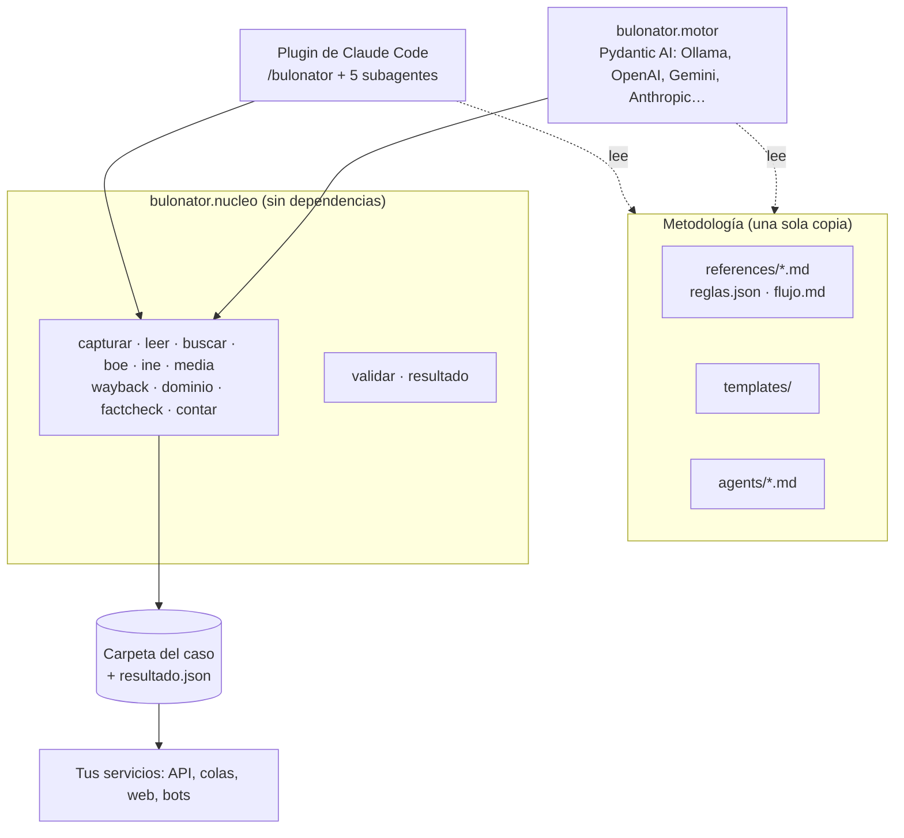
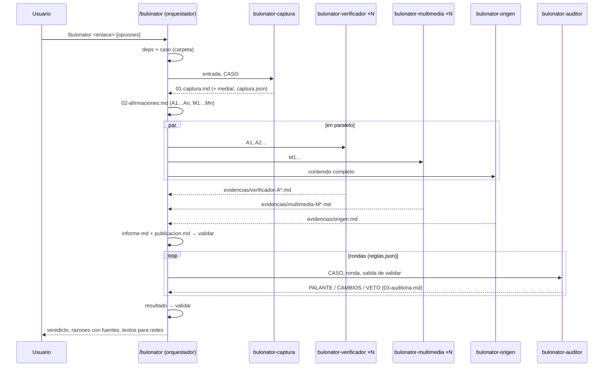

# Arquitectura

## Visión general

Bulonator tiene tres capas y dos maneras de usarse:

| Capa | Dónde | Qué es |
|---|---|---|
| Metodología | `skills/bulonator/references/`, `templates/` y `agents/` | Las reglas, las cifras (`reglas.json`), las plantillas y el papel de cada agente. Cada regla tiene un identificador y vive en un solo archivo |
| Núcleo | `src/bulonator/nucleo/` | Operaciones deterministas sin dependencias (Python 3.9+): captura, `leer`, `buscar`, fuentes oficiales, multimedia, Wayback, `validar` y `resultado` |
| Orquestación | `skills/*/SKILL.md` + subagentes (Claude Code) o `motor/src/bulonator/motor/` (Pydantic AI) | Quién decide qué paso viene después y con qué modelo |

Hay dos paquetes de Python que comparten el espacio de nombres `bulonator`. `bulonator-nucleo` (el `pyproject.toml` de la raíz) aporta `bulonator`, `bulonator.nucleo`, la orden `bulonator` y la metodología. `bulonator` (`motor/pyproject.toml`) aporta solo `bulonator.motor` y depende del primero. En un clon del repositorio, `bulonator/__init__.py` añade `motor/src` a su ruta, así que las pruebas y el desarrollo funcionan sin instalar nada.

Los dos orquestadores escriben **la misma carpeta de caso**, y `validar` y `resultado` la comprueban y la resumen con el mismo código. A un programa que lea `resultado.json` le da igual quién hizo el caso.

## En Claude Code

- La skill `/bulonator` se ejecuta en la conversación principal y hace de **orquestador**, la mesa de verificación.
- Los subagentes no pueden lanzar otros subagentes, así que la coordinación la hace la skill.
- Las fases son las de [`flujo.md`](../skills/bulonator/references/flujo.md). `SKILL.md` solo contiene lo que es propio de Claude Code: rutas, cómo lanzar subagentes en paralelo y qué mostrar en el chat.
- Cada capacidad (`leer`, `buscar`, `boe`…) se traduce a una herramienta de Claude Code o a una orden del script según [`herramientas-claude.md`](../skills/bulonator/references/herramientas-claude.md).
- `skills/bulonator/scripts/bulonator.py` es un lanzador del paquete. Lo busca en tres sitios, por este orden:
  1. en `scripts/_vendor/`, la copia que deja `install.sh`;
  2. en `src/` del repositorio, si se instala como plugin o con `--link`;
  3. en un paquete instalado.

## En el motor

El motor (`motor/src/bulonator/motor/`) fija las fases en código. El modelo decide solo dentro de cada fase y recibe herramientas tipadas, nunca una terminal. [docs/motor.md](motor.md) lo explica con detalle.

| Módulo | Qué hace |
|---|---|
| `config.py` | `Config`: el modelo de cada papel, el modo, el buscador y los límites |
| `prompts.py` | Monta las instrucciones de cada papel con la metodología del repositorio. Descarta las secciones «Lo que recibes…» y «Salida» de los agentes, que son de Claude Code |
| `herramientas.py` | Las capacidades como herramientas de Pydantic AI, con `Servicios` (las funciones del núcleo, sustituibles) y `Contexto` |
| `esquemas.py` | Las salidas estructuradas de cada papel y `Resultado`, validados contra `reglas.json` |
| `render.py` | Escribe los documentos del caso con el formato de las plantillas |
| `proceso.py` | El proceso completo: rondas, reintentos, fallos parciales, presupuesto y eventos de progreso |

## La cadena de evidencias

Esta es la garantía central del proyecto: **cada afirmación verificada tiene una fuente rastreable**, y eso **se comprueba con código**.

1. Toda fuente que se cite se abre con `leer`, o con una herramienta que registra lo que devuelve (`boe`, `ine_datos`, `wayback`…). Su texto queda en `evidencias/paginas/` y su entrada, en `indice.jsonl`.
2. Cada agente escribe sus hallazgos como entradas `E-…` con el formato de [`formato-evidencias.md`](../skills/bulonator/references/formato-evidencias.md).
3. `validar` comprueba que:
   - cada URL de una evidencia está registrada;
   - cada cita literal aparece en el texto guardado (admite cortes con «…» y traducciones entre corchetes);
   - cada `[n]` del informe existe y procede de una evidencia;
   - la calificación es la misma en todos los textos y la confianza está permitida;
   - los textos para X caben.

   En el motor, esto se comprueba antes de aceptar la salida de cada agente.
4. El auditor recibe el resultado de `validar`, extrae las frases factuales, las relaciona con `[n]` y `E-…` y **reabre las fuentes**.
5. `resultado` monta `resultado.json` a partir de los documentos, y `validar` lo comprueba una última vez.

## Decisiones de diseño

- **Una regla, un sitio.** Cada regla normativa tiene un identificador (`[EV-4]`, `[CAL-9]`…) y se define en negrita en un único archivo. Los demás la citan por su identificador. `tests/test_metodologia.py` comprueba tres cosas:
  - que cada regla se define una sola vez;
  - que todas las referencias existen;
  - que no hay pasajes de 12 palabras o más copiados entre archivos.
- **Las cifras, en datos.** `reglas.json` es la única fuente de los límites, las listas cerradas y los modos. Lo usan el núcleo, el motor y los agentes.
- **Agentes neutros.** Las secciones compartidas de los agentes nombran capacidades, no herramientas de Claude Code, y una prueba lo verifica. Lo propio de Claude Code está en «Lo que recibes…», «Salida» y `herramientas-claude.md`.
- **Subagentes o papeles en paralelo.** Cada uno tiene su propio contexto. Así la investigación de una afirmación no contamina la de otra, y el tiempo total se reduce.
- **Un auditor independiente con veto.** Traslada el filtro de verificación múltiple de Maldita.es. En el motor puede ser un modelo de otro proveedor, para que sus errores no vayan correlacionados con los del redactor.
- **Un núcleo sin dependencias.** El plugin funciona con el Python del sistema sin `pip install`. El motor añade Pydantic AI como extra opcional.
- **Defensa en profundidad.**
  - El contenido investigado se trata como datos, no como instrucciones [MET-11].
  - El motor no da una terminal al modelo.
  - La red local y el servicio de metadatos de la nube se bloquean, también tras una redirección.
  - Las herramientas de archivos se limitan a la carpeta del caso.

## Cómo ampliar Bulonator

| Quiero… | Dónde |
|---|---|
| Añadir una fuente oficial | `skills/bulonator/references/fuentes-oficiales.md`. Ejecuta `python3 tests/check_links.py` |
| Añadir un verificador o una web satírica | `skills/bulonator/references/verificadores.md` |
| Capturar una plataforma nueva | Una función `capture_<plataforma>()` en `src/bulonator/nucleo/captura.py`, la detección en `detect_platform()` y una prueba en `tests/test_bulonator.py` |
| Añadir una API oficial estructurada (como `boe` o `ine`) | Una función en `nucleo/fuentes.py` que registre lo que devuelve, su subcomando en `cli.py`, su herramienta en `motor/herramientas.py` (y en `POR_PAPEL`), su fila en `herramientas-claude.md` y su documentación en `fuentes-oficiales.md` |
| Cambiar una regla o una cifra | Su archivo de referencia o `reglas.json`, nunca una copia. Abre antes un issue de metodología |
| Añadir un agente | `agents/<nombre>.md`, con las secciones «Lo que recibes…», «Referencias» y «Salida»; su encargo en `flujo.md` y en `SKILL.md`; y su papel en el motor (`PAPELES`, `POR_PAPEL` y `proceso.py`) |
