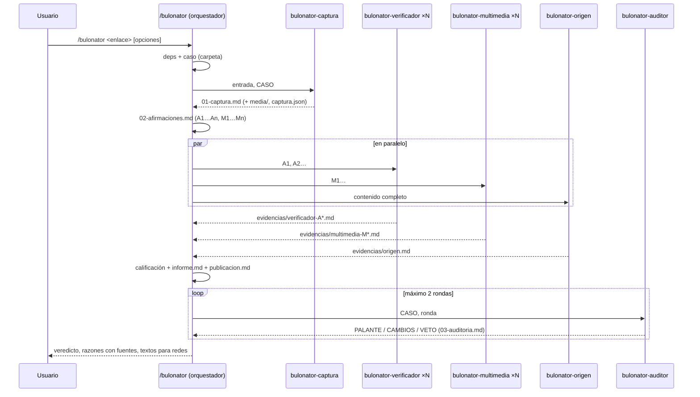

# Arquitectura

## Visión general

Bulonator es un **plugin de Claude Code** formado por tres skills, cinco subagentes y un script de herramientas en Python. Solo usa la biblioteca estándar de Python.

- La skill `/bulonator` se ejecuta en la conversación principal y actúa como **orquestador**: es la mesa de verificación.
- Los subagentes no pueden lanzar otros subagentes. Por eso toda la coordinación la hace la skill.

## Responsabilidades

| Pieza | Hace | No hace |
|---|---|---|
| Orquestador (`skills/bulonator/SKILL.md`) | Prepara el caso, desglosa las afirmaciones, reparte encargos, delibera la calificación y redacta | Inventar fuentes; saltarse la auditoría |
| `bulonator-captura` | Preserva el contenido literal, los metadatos de publicación, la multimedia y las copias archivadas | Valorar la veracidad |
| `bulonator-verificador` | Contrasta afirmaciones con fuentes oficiales y primarias, con citas literales y búsquedas documentadas | Dar el veredicto global; redactar para redes |
| `bulonator-multimedia` | Procedencia, fecha, lugar, manipulación, IA y audio | Concluir que algo es IA solo por señales visuales |
| `bulonator-origen` | Desmentidos previos, primera aparición, perfil de la fuente e indicios de difusión | Atribuir la autoría o hablar de "bots" sin pruebas |
| `bulonator-auditor` | Trazabilidad frase → evidencia → fuente; reapertura de fuentes; metodología y ética; veto | Repetir toda la investigación |
| `bulonator.py` | Operaciones deterministas: captura por API, descargas, ffmpeg, Wayback, RDAP, BOE, INE y recuento de caracteres | Decidir nada |

## La cadena de evidencias

Esta es la garantía central del proyecto: **cada afirmación verificada tiene una fuente rastreable**.

1. Cada agente escribe sus hallazgos como entradas `E-…`, con la URL abierta, la fecha, el tipo de fuente, la cita literal, su ubicación y lo que demuestra y lo que no (ver [`formato-evidencias.md`](../skills/bulonator/references/formato-evidencias.md)).
2. Las búsquedas sin resultado también se registran, porque sostienen las conclusiones del tipo "no consta".
3. El orquestador solo puede numerar como fuente `[n]` una URL que tenga una entrada `E-…`, y anota los ID en comentarios HTML junto a cada párrafo del informe.
4. El auditor extrae todas las frases factuales de los textos finales, las mapea a `[n]` y a `E-…`, y **reabre las fuentes** para confirmar las citas y las cifras.

## Decisiones de diseño

- **Subagentes especializados en paralelo.** Cada uno tiene su propio contexto, con instrucciones y herramientas propias. Así la investigación de una afirmación no contamina la de otra y el tiempo total se reduce.
- **Un auditor independiente con veto.** Traslada el "filtro de verificación múltiple" de Maldita.es. El auditor no participó en la investigación, así que revisa sin sesgo de confirmación. Con `--profundo` hay dos auditores con enfoques distintos.
- **Un script sin dependencias.** Cualquiera con Python 3.9 o superior puede usarlo sin `pip install`. Las capacidades extra (`yt-dlp`, `ffmpeg`, `exiftool`, `whisper`) se detectan con `deps` y, si faltan, se declaran como limitación en lugar de fallar.
- **Las rutas se resuelven con `${CLAUDE_SKILL_DIR}`.** Claude Code lo sustituye en la skill por su ruta real, tanto si se instala como plugin como si está en `~/.claude/skills/`. El orquestador pasa rutas absolutas a los subagentes en el prompt.
- **Defensa contra la inyección de instrucciones.** Todo el contenido capturado se trata como datos. Los agentes tienen instrucciones explícitas de no obedecer órdenes incrustadas y de anotarlas como indicio.
- **Herramientas mínimas por agente.** Captura, verificador y auditor tienen una lista cerrada de herramientas. Multimedia y origen heredan todas, para poder usar un navegador MCP si lo hay (búsqueda inversa, redes que necesitan JavaScript).

## Cómo ampliar Bulonator

| Quiero… | Dónde |
|---|---|
| Añadir una fuente oficial | `skills/bulonator/references/fuentes-oficiales.md`. Ejecuta `python3 tests/check_links.py` |
| Añadir un verificador o una web satírica | `skills/bulonator/references/verificadores.md` |
| Capturar una plataforma nueva | Una función `capture_<plataforma>()` en `bulonator.py`, la detección en `detect_platform()` y una prueba en `tests/test_bulonator.py` |
| Añadir una API oficial estructurada (como `boe` o `ine`) | Un subcomando nuevo en `bulonator.py`, documentado en `fuentes-oficiales.md` |
| Cambiar los criterios de calificación | `calificaciones.md`. Abre antes un issue de metodología |
| Añadir un agente | `agents/<nombre>.md` y su encargo en la fase correspondiente de `skills/bulonator/SKILL.md` |
