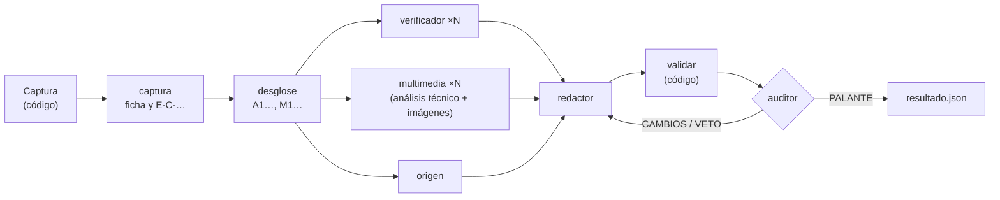

# El motor: Bulonator con tus propios modelos

El motor hace el mismo análisis que `/bulonator` en Claude Code, pero fuera de Claude Code y con el modelo que elijas:

- modelos locales con [Ollama](https://ollama.com);
- OpenAI, Gemini o Anthropic;
- cualquier modelo que admita [Pydantic AI](https://pydantic.dev/docs/ai/overview/).

Se usa de dos maneras:

- desde la línea de órdenes, con `bulonator analizar`;
- como **librería de Python**, para construir tus propios bots y servicios: una API REST, un trabajador de colas, un bot de Telegram o de Bluesky…

El motor usa **la misma metodología** que el plugin, sin copias propias:

- los mismos agentes (`agents/*.md`) y las mismas referencias y plantillas;
- las mismas comprobaciones (`validar`);
- el mismo formato de caso y de `resultado.json`.

Un caso generado por el motor y otro generado con Claude Code se leen igual.

> **La librería no publica nada.** Devuelve el caso y quien la usa decide qué hacer con él. La recomendación es que **una persona revise cada caso antes de publicarlo**, como en cualquier redacción de verificación.

## Índice

- [Instalación](#instalación)
- [Uso rápido](#uso-rápido)
- [Configuración](#configuración)
- [Modelos](#modelos)
- [Búsqueda web](#búsqueda-web)
- [Cómo trabaja](#cómo-trabaja)
- [Usarlo en un servicio](#usarlo-en-un-servicio)
- [Pruebas](#pruebas)
- [Limitaciones](#limitaciones)

## Instalación

El motor necesita **Python 3.11 o superior**, porque lo exige Pydantic AI. El núcleo (las herramientas del plugin) sigue funcionando con Python 3.9 y sin dependencias.

| Para… | Orden |
|---|---|
| Tener la orden `bulonator` en la terminal | `./install.sh --motor` (Claude Code y motor) o `./install.sh --solo-motor`. Usa [uv](https://docs.astral.sh/uv/) o pipx y deja el motor en un entorno aislado |
| Usarlo como librería en otro proyecto | `pip install bulonator` o `uv add bulonator` |
| Usar la versión de GitHub | `pip install "bulonator-nucleo @ git+https://github.com/bbotella/bulonator" "bulonator @ git+https://github.com/bbotella/bulonator#subdirectory=motor"` |
| Desarrollar | `pip install -e . -e "./motor[evals]"` en un entorno virtual con Python 3.11 o superior |

Bulonator se publica en dos paquetes, y los dos se importan como `bulonator`:

| Paquete | Contiene | Python | Dependencias |
|---|---|---|---|
| [`bulonator`](https://pypi.org/project/bulonator/) | El motor (`bulonator.motor`) | 3.11+ | `bulonator-nucleo` (de la misma versión), `pydantic-ai-slim` con OpenAI (que también cubre Ollama), Google y Anthropic, y `pypdf` |
| [`bulonator-nucleo`](https://pypi.org/project/bulonator-nucleo/) | El núcleo (`bulonator.nucleo`), la orden `bulonator` y la metodología | 3.9+ | Ninguna |

`pip install bulonator` instala los dos. Si solo necesitas las herramientas, sin modelos, instala `bulonator-nucleo`.

Las herramientas externas son las mismas que para el plugin: `yt-dlp`, `ffmpeg` y, si quieres, `exiftool`, `c2patool` y `whisper`. Compruébalas con `bulonator deps`.

## Uso rápido

### En la terminal

```bash
bulonator analizar https://x.com/usuario/status/1234567890 --modelo ollama:gpt-oss:20b
bulonator analizar "Desde enero los mayores de 65 pagarán un 20% más de IRPF" --modo rapido
bulonator analizar foto.jpg --config bulonator.toml --auditor openai:<modelo>
```

El progreso sale por la salida de errores. Por la salida estándar sale un JSON con:

- la ruta del caso;
- si está aprobado (`aprobado`);
- la validación;
- el uso de cada papel;
- `resultado`, con el contenido de `resultado.json`.

| Código de salida | Significado |
|---|---|
| 0 | Análisis terminado. Mira `aprobado` y `validacion` antes de usar el resultado |
| 3 | El motor no está instalado o la versión de Python es anterior a la 3.11 |
| 4 | No se pudo obtener el contenido. Consigue el texto, una captura de pantalla o el archivo |
| 5 | Se ha agotado el presupuesto de tokens (`max_tokens_caso`) |

### Como librería

```python
import asyncio
from bulonator import analizar, Config

config = Config(
    modelos={
        "defecto": "ollama:gpt-oss:20b",   # todos los papeles…
        "auditor": "openai:<modelo>",       # …salvo el auditor, de otro proveedor
    },
    carpeta_casos="./casos",
)

caso = asyncio.run(analizar("https://bsky.app/profile/…/post/…", config, al_progresar=print))

caso.ruta                               # carpeta con informe.md, publicacion.md, evidencias/…
caso.resultado.calificacion             # "FALSO"
caso.resultado.subtipo                  # "descontextualizado"
caso.resultado.confianza                # "ALTA"
caso.resultado.etiqueta                 # "❌ FALSO"
caso.resultado.publicaciones["breve"]   # texto para X, Bluesky, Threads o Mastodon
caso.resultado.publicaciones["hilo_x"]  # lista de publicaciones del hilo
caso.resultado.fuentes                  # [n], URL, tipo de fuente y evidencias de cada una
caso.aprobado                           # auditoría superada y validación mecánica sin errores
caso.informe                            # texto de informe.md
```

`analizar` es asíncrona. Fuera de un bucle de eventos puedes usar `analizar_sync(...)`.

## Configuración

`Config` se crea en código o se lee de un archivo TOML con `Config.desde_toml("bulonator.toml")`. En la terminal se pasa con `--config`, y las demás opciones de la orden se aplican encima.

```toml
# bulonator.toml
modo = "normal"            # rapido | normal | profundo
idioma = "es"              # idioma de los textos para redes
buscador = "auto"          # auto | nativo | searxng | brave | tavily | ninguno
carpeta_casos = "bulonator-casos"
concurrencia = 2           # papeles trabajando a la vez (con Ollama local, 1 o 2)
max_peticiones = 40        # peticiones al modelo por cada papel
# max_tokens_caso = 400000 # presupuesto total del caso (sin límite si no se indica)
vision = true              # adjuntar imágenes a los modelos (desactívalo si el modelo no las admite)

[modelos]
defecto = "ollama:gpt-oss:20b"
multimedia = "ollama:<modelo-con-visión>"   # p. ej. de las familias Qwen-VL o Gemma, para imágenes y fotogramas
auditor = "google:<modelo>"
```

| Opción | Por defecto | Qué hace |
|---|---|---|
| `modelos` | `{"defecto": "ollama:gpt-oss:20b"}` | El modelo de cada papel: `captura`, `desglose`, `verificador`, `multimedia`, `origen`, `redactor`, `auditor`. `defecto` cubre los que no tienen modelo propio. Admite el texto de Pydantic AI o un objeto `Model` ya construido |
| `modo` | `normal` | Cuántos verificadores, análisis multimedia y auditores se lanzan (`reglas.json` → `modos`) |
| `idioma` | `es` | Idioma de los textos para redes |
| `archivar` | `false` | Solicita copias nuevas en la Wayback Machine |
| `buscador` | `auto` | Ver [Búsqueda web](#búsqueda-web) |
| `concurrencia` | 2 | Papeles que trabajan a la vez |
| `max_peticiones` | 40 | Límite de peticiones al modelo en cada ejecución de un papel |
| `max_tokens_caso` | sin límite | Presupuesto total de tokens del caso. Al superarlo se lanza `PresupuestoAgotado` |
| `reintentos` | 3 | Veces que se devuelve una salida al modelo cuando no supera la validación |
| `max_texto_herramienta` | 6000 | Caracteres que devuelve `leer` en cada llamada (los documentos largos se leen por trozos) |
| `vision` / `max_imagenes` | `true` / 6 | Si se adjuntan imágenes y cuántas como máximo |
| `temperatura` | 0.2 | Temperatura de los modelos (`null` para la del proveedor) |
| `permitir_red_privada` | `false` | Permite URL de la red local. **No lo actives en un servicio** |

## Modelos

Cada papel puede usar un modelo distinto. Algunas recomendaciones:

- **Un auditor de otro proveedor.** La auditoría con veto traslada el filtro de verificación múltiple de Maldita.es. Si el auditor es de otra familia de modelos, sus errores no van correlacionados con los del redactor.
- **Visión para el análisis multimedia.** Los papeles `captura` y `multimedia` reciben imágenes adjuntas: las fotos, el ELA y la hoja de contactos de los vídeos. Si el modelo no admite imágenes, pon `vision = false` y el análisis se apoyará solo en los metadatos y en las búsquedas.
- **Herramientas.** Los papeles que investigan llaman a herramientas, así que el modelo tiene que admitir llamadas a funciones.

| Proveedor | Texto del modelo | Configuración |
|---|---|---|
| Ollama (local) | `ollama:<modelo>`, por ejemplo `ollama:gpt-oss:20b` | `OLLAMA_BASE_URL` (por defecto `http://localhost:11434/v1`) |
| OpenAI | `openai:<modelo>` | `OPENAI_API_KEY` |
| Google Gemini | `google:<modelo>` | `GOOGLE_API_KEY` |
| Anthropic | `anthropic:<modelo>` | `ANTHROPIC_API_KEY` |
| Otros (OpenRouter, Groq, Mistral…) | Ver la [documentación de Pydantic AI](https://pydantic.dev/docs/ai/overview/) | La de cada proveedor |

Para un servidor compatible con la API de OpenAI (LM Studio, vLLM, llama.cpp…), construye el modelo y pásalo como objeto:

```python
from pydantic_ai.models.openai import OpenAIChatModel
from pydantic_ai.providers.openai import OpenAIProvider

local = OpenAIChatModel("mi-modelo", provider=OpenAIProvider(base_url="http://localhost:1234/v1"))
config = Config(modelos={"defecto": local})
```

### Ollama: amplía el contexto

Cada papel recibe su metodología y sus referencias: entre 4.500 y 7.500 palabras, unos 7.000-12.000 tokens, más lo que lea. El contexto por defecto de Ollama es pequeño, así que **arráncalo con al menos 32.768 tokens de contexto**. Si los documentos son largos, mejor 65.536.

```bash
OLLAMA_CONTEXT_LENGTH=32768 ollama serve
```

En la aplicación de escritorio de Ollama, el contexto se cambia en los ajustes. Espera que los modelos locales cometan más errores que los grandes modelos comerciales. Por eso la validación mecánica rechaza citas y URL inventadas, y el auditor puede ser de otro proveedor.

## Búsqueda web

Sin búsqueda web, el verificador y el rastreo del origen trabajan casi a ciegas. Puedes configurarla de cuatro maneras:

| `buscador` | Cómo busca |
|---|---|
| `auto` (por defecto) | Si hay un buscador propio configurado, lo usa. Si no, y el modelo es de Anthropic, OpenAI o Google, usa la búsqueda nativa del proveedor. Si tampoco, no hay búsqueda, y queda declarado como limitación |
| `searxng` | Tu propia instancia de [SearXNG](https://docs.searxng.org/), gratuita y privada. Define `BULONATOR_SEARXNG_URL`, por ejemplo `http://localhost:8080`, y activa el formato `json` en su `settings.yml` (`search.formats`) |
| `brave` | La API de Brave Search, con `BRAVE_API_KEY` |
| `tavily` | La API de Tavily, con `TAVILY_API_KEY` |
| `nativo` | Siempre la búsqueda nativa del proveedor (solo Anthropic, OpenAI y Google) |
| `ninguno` | Sin búsqueda web |

Para levantar SearXNG en local, por ejemplo:

```bash
podman run -d -p 8080:8080 docker.io/searxng/searxng
```

Recuerda activar el formato JSON en su configuración. Los resultados de búsqueda solo sirven para encontrar páginas: un extracto de buscador nunca es una evidencia, y la página se abre con `leer`. Las búsquedas hechas con un buscador propio quedan anotadas en `evidencias/busquedas.jsonl`.

## Cómo trabaja

El orden de las fases de [`flujo.md`](../skills/bulonator/references/flujo.md) está fijado en el código. El modelo solo decide dentro de cada fase.



- **Metodología.** Cada papel recibe las secciones compartidas de su agente; las secciones «Lo que recibes…» y «Salida» son de Claude Code y se descartan. El desglose y la redacción usan su sección de `flujo.md`. A eso se añaden las referencias que lista el agente, las que definen las reglas que cita (por ejemplo, `[CAL-9]` añade `calificaciones.md`) y `reglas.json`. Puedes ver las instrucciones completas de un papel con `bulonator.motor.prompts.instrucciones("verificador", Config())`.
- **Herramientas tipadas, nunca una terminal.** Cada papel tiene solo sus herramientas: `leer`, `buscar`, `boe`, `boe_sumario`, `ine_operaciones`, `ine_tablas`, `ine_datos`, `wayback`, `dominio`, `factcheck`, `buscar_imagen`, `media`, `ver_imagen` y `capturar`. Todo lo que abren queda registrado en el caso.
- **Validación antes de aceptar cada salida.** Las evidencias de cada agente se comprueban con el mismo código que `bulonator validar`:
  - la URL tiene que estar abierta;
  - la cita literal tiene que estar en el texto guardado;
  - el identificador tiene que ser válido y no repetido;
  - el tipo de fuente tiene que estar en `reglas.json`.

  Si algo falla, la salida se devuelve al modelo con la lista de problemas. Agotados los reintentos, las evidencias que siguen mal se descartan y se anotan como laguna. El informe y los textos se validan del mismo modo antes de la auditoría.
- **Auditoría y rondas.** Se aplica el apartado «Auditoría y cierre» de `flujo.md`:
  - con PALANTE, se cierra el caso;
  - con CAMBIOS, se aplican; si afectan a la calificación o a una cifra, hay otra ronda;
  - con VETO, se corrige y hay otra ronda.

  Si después de la última ronda no hay PALANTE, se aplica la regla de cierre: el caso queda con `auditoria.cierre = true` y sin aprobar. Si el auditor falla, cuenta como un VETO.
- **Fallos parciales.** Si un verificador o el rastreo del origen no terminan, el caso sigue: el fallo se declara como limitación y queda en `caso.fallos`.

## Usarlo en un servicio

Un análisis tarda minutos, así que en un servicio conviene lanzarlo en segundo plano. Tus proyectos pueden encargarse de:

- **Trabajos asíncronos.** Encola el análisis (Celery, RQ, Arq, una tabla de trabajos…) y devuelve un identificador. `al_progresar` recibe un `Evento(fase, mensaje, datos)` en cada paso, con funciones normales o asíncronas, y sirve para informar del progreso.
- **Casos repetidos.** El mismo enlace normalizado (`bulonator.nucleo.normalizar_url`) debería devolver el caso que ya existe, en lugar de analizarlo otra vez.
- **Límites.** Pon límites por usuario y un presupuesto por caso (`max_tokens_caso`, `max_peticiones`).
- **`CapturaVacia`.** Si no se puede obtener el contenido, pide a quien lo envió el texto, una captura de pantalla o el archivo.
- **Revisión humana antes de publicar.** Usa `caso.aprobado` (PALANTE o cambios aplicados, sin regla de cierre y con la validación sin errores) como requisito mínimo, nunca como permiso para publicar sin supervisión. Un veredicto erróneo publicado automáticamente es el peor fallo posible: puede ser difamatorio y es justo lo que buscaría quien quisiera manipular el bot. Responder en privado a quien pregunta tiene mucho menos riesgo que publicar en una cuenta pública.
- **Seguridad.**
  - El modelo no tiene terminal.
  - Las URL de la red local, de la propia máquina o del servicio de metadatos de la nube se bloquean, también tras una redirección.
  - Los archivos que pueden abrir las herramientas se limitan a la carpeta del caso.
  - Aun así, ejecuta los trabajadores en un contenedor sin credenciales, porque el análisis descarga contenido de terceros y ejecuta `yt-dlp` y `ffmpeg` sobre él.

### Herramientas en tus propios agentes

Las herramientas se pueden reutilizar en agentes propios de Pydantic AI:

```python
from pathlib import Path
from pydantic_ai import Agent
from bulonator.motor import Config, Contexto, toolset
from bulonator.nucleo import crear_caso

caso = Path(crear_caso("mi consulta")["caso"])
agente = Agent("ollama:gpt-oss:20b", deps_type=Contexto, toolsets=[toolset("verificador")])
respuesta = agente.run_sync("¿Qué dice el BOE sobre el ingreso mínimo vital?", deps=Contexto(caso, Config()))
```

`bulonator.nucleo` ofrece además las funciones sin modelo: `capturar`, `leer`, `buscar`, `boe`, `ine_datos`, `wayback`, `analizar_media`, `validar`, `construir_resultado`… Funcionan con Python 3.9 y sin dependencias.

## Pruebas

Las pruebas del motor usan los modelos simulados de Pydantic AI (`FunctionModel`): no llaman a ningún modelo ni necesitan red.

```bash
pip install -e . -e ./motor
python -m unittest discover -s tests -v
```

`tests/test_motor.py` guioniza cada papel y recorre el caso entero. Cubre estas situaciones:

- PALANTE, CAMBIOS sin nueva ronda, y VETO con la regla de cierre;
- una cita inventada que se corrige al reintentar, y otra que se descarta al agotar los reintentos;
- el análisis multimedia con imágenes;
- la ronda dirigida;
- el fallo de un verificador o del auditor;
- el presupuesto de tokens agotado y la búsqueda nativa.

Para comparar modelos con casos reales ya verificados, `pip install "bulonator[evals]"` añade `pydantic-evals`.

## Limitaciones

- **No hay navegador.** La búsqueda inversa de imágenes solo da resultados automáticos con `SERPAPI_API_KEY`; si no, quedan los enlaces para revisarlos a mano. Las webs que necesitan JavaScript o iniciar sesión se declaran como laguna.
- **Un VETO no abre una investigación nueva.** El redactor corrige con las evidencias que ya hay, normalmente bajando la calificación o la confianza. La única ronda de investigación adicional es la dirigida sobre la afirmación central [FLU-3].
- **Los modelos pequeños se equivocan más.** La validación mecánica impide citar lo que no se ha abierto, pero no evita una mala interpretación de una fuente real. Para eso está la auditoría y, sobre todo, la revisión humana.
